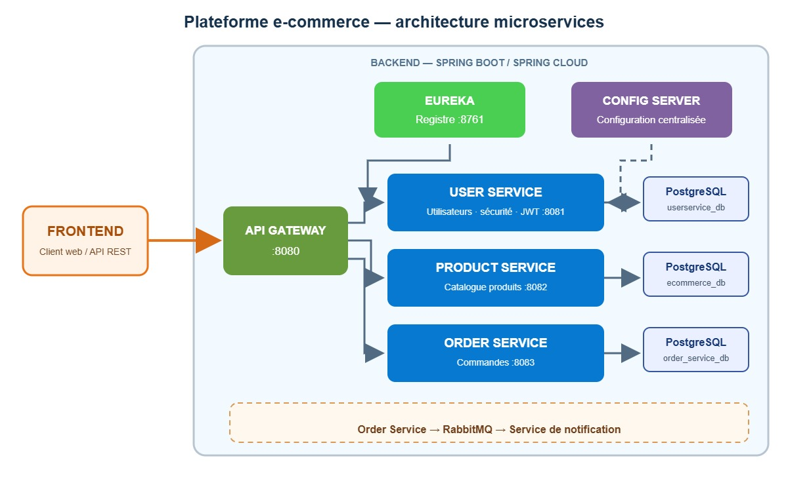
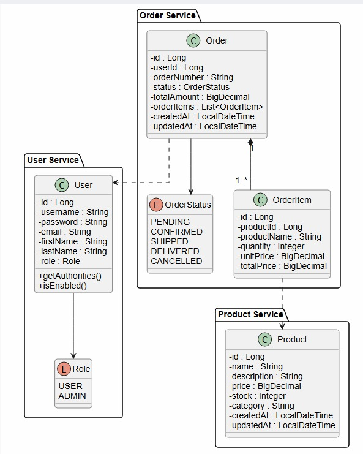

# E-Commerce Microservices Platform

A Java 21 / Spring Boot 3.2 e-commerce backend organized as independently
deployable services. It includes user authentication, product catalog and order
management, with Eureka discovery, centralized configuration, an API Gateway,
OpenFeign service calls, and RabbitMQ order-created events.

> The repository is named as an AI architecture project, but this backend
> currently contains no AI service or AI endpoints.

## Architecture

### Global architecture



### Domain class diagram



The class diagram shows the core `User`, `Product`, `Order`, and `OrderItem`
models. The current order implementation also stores an idempotency key.

## Services and local ports

| Module | Responsibility | Default port |
| --- | --- | ---: |
| `config-server` | Loads shared service properties from the `config-repo` directory in the configured Git repository | 8888 |
| `eureka-server` | Service registry and discovery | 8761 |
| `gateway-service` | Entry point that routes requests to services discovered in Eureka | 8080 |
| `user-service` | User registration, login, and user lookup | 8081 |
| `product-service` | Product catalog operations | 8082 |
| `order-service` | Order creation, lookup, and status updates | 8083 |
| RabbitMQ | Asynchronous order-created event broker | 5672 (AMQP), 15672 (management UI) |
| PostgreSQL | Separate database for each business service | 5432 |

Each business service owns its database:

| Database | Service |
| --- | --- |
| `userservice_db` | User service |
| `ecommerce_db` | Product service |
| `order_service_db` | Order service |

## How service communication works

- The Gateway routes requests using Eureka service IDs. For example,
  `/order-service/api/orders` routes to the order service.
- The order service uses OpenFeign and Eureka discovery to call the product
  service (`GET /api/products/{id}`) and user service
  (`GET /api/auth/users/{id}`).
- After an order transaction commits, the order service publishes a JSON
  `OrderCreatedEvent` to the `ecommerce.exchange` topic exchange with routing
  key `order.created`. The durable queue is `order.created.queue`.
- No notification consumer is included yet; events remain queued until a
  consumer is added.

## Technology

- Java 21
- Maven multi-module build
- Spring Boot 3.2.0
- Spring Cloud 2023.0.0
- Spring Web, Spring Data JPA, Spring Security, Bean Validation
- Spring Cloud Config, Netflix Eureka, Spring Cloud Gateway
- Spring Cloud OpenFeign and Spring Cloud LoadBalancer
- Spring AMQP / RabbitMQ
- PostgreSQL
- Lombok

## Prerequisites

- JDK 21
- Maven 3.8+
- Docker Desktop (for RabbitMQ)
- PostgreSQL running on port `5432`
- Git access to the configured repository and its `v5` branch (Config Server
  loads its properties from that branch)

Create these PostgreSQL databases before starting the business services:

```sql
CREATE DATABASE userservice_db;
CREATE DATABASE ecommerce_db;
CREATE DATABASE order_service_db;
```

The configured database user is `postgres`. Set the password in the environment
instead of relying on the development fallback:

```powershell
$env:DB_PASSWORD = "your-local-postgres-password"
$env:JWT_SECRET = "a-long-random-secret-for-local-development"
```

The database schema is managed with Hibernate `ddl-auto=update` for development.
Use a migration tool and review schema changes before production use.

## Start the project

### 1. Start RabbitMQ

Start Docker Desktop, then run:

```powershell
docker run -d --name ecommerce-rabbitmq --restart unless-stopped `
  -p 5672:5672 -p 15672:15672 `
  -e RABBITMQ_DEFAULT_USER=ecommerce `
  -e RABBITMQ_DEFAULT_PASS=ecommerce123 `
  rabbitmq:3-management
```

If the container already exists, start it with:

```powershell
docker start ecommerce-rabbitmq
```

Open [http://localhost:15672](http://localhost:15672) and sign in with
`ecommerce` / `ecommerce123`. These credentials are for local development only.
The order service reads its RabbitMQ password from `RABBITMQ_PASSWORD`:

```powershell
$env:RABBITMQ_PASSWORD = "ecommerce123"
```

### 2. Build the Maven project

From the repository root:

```powershell
mvn clean compile
```

### 3. Run each service in its own terminal

Run each command from the repository root. Start in this order and keep all
terminals open:

```powershell
mvn spring-boot:run -pl config-server
```

```powershell
mvn spring-boot:run -pl eureka-server
```

```powershell
mvn spring-boot:run -pl user-service
```

```powershell
mvn spring-boot:run -pl product-service
```

```powershell
mvn spring-boot:run -pl order-service
```

Before starting `order-service`, set `RABBITMQ_PASSWORD` in that terminal.

```powershell
mvn spring-boot:run -pl gateway-service
```

Confirm service registration at [http://localhost:8761](http://localhost:8761).
The Gateway is available at `http://localhost:8080`.

## REST API

Requests can be sent directly to the service ports or through the Gateway. The
examples below use the Gateway (`http://localhost:8080`).

### User service

| Method | Path | Purpose |
| --- | --- | --- |
| `POST` | `/user-service/api/auth/register` | Register a user |
| `POST` | `/user-service/api/auth/register-admin` | Register an administrator |
| `POST` | `/user-service/api/auth/login` | Log in |
| `POST` | `/user-service/api/auth/test` | Test endpoint |
| `POST` | `/user-service/api/auth/validate` | Token validation placeholder |
| `GET` | `/user-service/api/auth/users` | List users |
| `GET` | `/user-service/api/auth/users/{id}` | Get a user by ID |

Register body:

```json
{
  "username": "demo-user",
  "password": "ChangeThisPassword1!",
  "email": "demo@example.com",
  "firstName": "Demo",
  "lastName": "User"
}
```

Login body:

```json
{
  "username": "demo-user",
  "password": "ChangeThisPassword1!"
}
```

### Product service

| Method | Path | Purpose |
| --- | --- | --- |
| `GET` | `/product-service/api/products` | List products |
| `GET` | `/product-service/api/products/{id}` | Get a product |
| `POST` | `/product-service/api/products` | Create a product |
| `PUT` | `/product-service/api/products/{id}` | Update a product |
| `DELETE` | `/product-service/api/products/{id}` | Delete a product |
| `POST` | `/product-service/api/products/batch` | Get products by IDs |

Product body:

```json
{
  "name": "Example Product",
  "description": "Product description",
  "price": 49.90,
  "stock": 10,
  "category": "Example"
}
```

Batch request body:

```json
[1, 2, 3]
```

### Order service

| Method | Path | Purpose |
| --- | --- | --- |
| `POST` | `/order-service/api/orders` | Create an order; requires `Idempotency-Key` header |
| `GET` | `/order-service/api/orders/{id}` | Get an order |
| `GET` | `/order-service/api/orders/{id}/detail` | Get order with live user/product details |
| `GET` | `/order-service/api/orders/order-number/{orderNumber}` | Get order by order number |
| `GET` | `/order-service/api/orders/user/{userId}` | List a user's orders |
| `PUT` | `/order-service/api/orders/{orderNumber}/status?status=CONFIRMED` | Update order status |

Order creation body:

```json
{
  "userId": 1,
  "orderItems": [
    {
      "productId": 1,
      "quantity": 2
    }
  ]
}
```

Example headers:

```text
Content-Type: application/json
Idempotency-Key: demo-order-001
```

The idempotency key must be unique for each new order. Reusing an existing key
is rejected. Valid order statuses are `PENDING`, `CONFIRMED`, `SHIPPED`,
`DELIVERED`, and `CANCELLED`.

### Direct service URLs

For testing without the Gateway, replace the service prefix with:

- User service: `http://localhost:8081`
- Product service: `http://localhost:8082`
- Order service: `http://localhost:8083`

## RabbitMQ order event

On successful order transaction commit, the order service publishes a JSON
event containing the order ID, order number, user ID, and total amount.

- Exchange: `ecommerce.exchange` (topic)
- Queue: `order.created.queue` (durable)
- Routing key: `order.created`
- Management console: [http://localhost:15672](http://localhost:15672)

The order service has a RabbitMQ exception handler that maps propagated AMQP
errors to HTTP `503 Service Unavailable`. Since publishing happens after the
database transaction commits, a broker failure may occur after the order itself
has already been stored.

## Configuration and security notes

- Central configuration files live in `config-repo/` and are served by Config
  Server on port `8888`.
- Config Server reads the `v5` branch of this repository.
- Set `DB_PASSWORD`, `JWT_SECRET`, and `RABBITMQ_PASSWORD` in each relevant
  service process environment. Never use development fallback credentials in
  production.
- The current user list and ID endpoints return the `User` entity. Review the
  API response and access controls before exposing these endpoints publicly.
- Service security and database migration settings are development-oriented;
  review them before deployment.

## Useful commands

```powershell
# Compile all Maven modules
mvn clean compile

# Compile only order-service and its required modules
mvn -pl order-service -am -DskipTests compile

# Check RabbitMQ container
docker ps --filter "name=ecommerce-rabbitmq"

# Stop / restart RabbitMQ
docker stop ecommerce-rabbitmq
docker start ecommerce-rabbitmq
```
